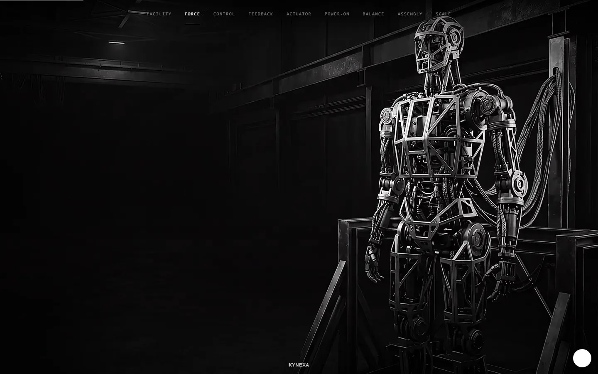

# scroll-wizard

## What it builds

scroll-wizard turns a short brief and a video (or an AI-generated one) into a
scroll-scrub video website: a canvas-driven frame sequence that plays as the
user scrolls, with copy overlays, holds, a poster frame, and an outro. It
ships as a cross-harness agent skill (`SKILL.md`) plus four standalone CLI
scripts, a static site template, and a scrub engine (`template/scrub-core.js`
+ `template/scrub-engine.js`) with an optional [Lenis](#license) smooth-scroll
layer.

## Demo

[](docs/demo/kynexa-demo.mp4)

**[Live demo](https://kynexa-demo.vercel.app)** (opens the generated KYNEXA site; click the image above for a
recording). The live page is for scrolling only: its buttons and links are
not functional.

## Prerequisites

- Node 20 or later — `node --version`
- ffmpeg — `ffmpeg -version`
- ffprobe (ships with ffmpeg) — `ffprobe -version`

If any check fails, install via your platform's package manager (e.g.
`winget install Gyan.FFmpeg`, `brew install ffmpeg`, `apt install ffmpeg`) and
make sure the install's `bin` directory is on `PATH`.

## Install as an agent skill

Installing is a junction (Windows) or symlink (Unix) from the harness's skill
directory to this repository — there is no install script.

### Claude Code

Unix:

```bash
mkdir -p ~/.claude/skills && ln -s /path/to/scroll-wizard ~/.claude/skills/scroll-wizard
```

PowerShell (Windows, run as the owning user):

```powershell
New-Item -ItemType Directory -Force -Path "$env:USERPROFILE\.claude\skills" | Out-Null
New-Item -ItemType Junction -Path "$env:USERPROFILE\.claude\skills\scroll-wizard" -Target "C:\path\to\scroll-wizard"
```

### Codex

Unix:

```bash
mkdir -p ~/.agents/skills && ln -s /path/to/scroll-wizard ~/.agents/skills/scroll-wizard
```

PowerShell (Windows):

```powershell
New-Item -ItemType Directory -Force -Path "$env:USERPROFILE\.agents\skills" | Out-Null
New-Item -ItemType Junction -Path "$env:USERPROFILE\.agents\skills\scroll-wizard" -Target "C:\path\to\scroll-wizard"
```

### Grok Build

Unix:

```bash
mkdir -p ~/.grok/skills && ln -s /path/to/scroll-wizard ~/.grok/skills/scroll-wizard
```

PowerShell (Windows):

```powershell
New-Item -ItemType Directory -Force -Path "$env:USERPROFILE\.grok\skills" | Out-Null
New-Item -ItemType Junction -Path "$env:USERPROFILE\.grok\skills\scroll-wizard" -Target "C:\path\to\scroll-wizard"
```

## Standalone CLI

The scripts work without any agent — install this package (or just clone the
repo and run Node directly) and call them from a terminal. Each `bin` name
below is equivalent to `node scripts/<file>.mjs`.

| Bin | Node script |
|---|---|
| `scroll-wizard-validate` | `node scripts/validate-media.mjs` |
| `scroll-wizard-extract` | `node scripts/extract-frames.mjs` |
| `scroll-wizard-scaffold` | `node scripts/scaffold-site.mjs` |
| `scroll-wizard-status` | `node scripts/status.mjs` |

### Validate media

Checks a video or image with ffprobe and reports decodability, dimensions,
duration/fps (video) or aspect (image), and warnings.

```bash
scroll-wizard-validate <file> [--json]
node scripts/validate-media.mjs <file> [--json]
```

Exit 0 on a valid file, 2 when the file is not decodable, 1 on usage errors.

### Extract frames

Extracts an evenly spaced sequence of frames from a video with ffmpeg.

```bash
scroll-wizard-extract <input.mp4> <outDir> --count 150 --width 1600 --format webp --quality 80 [--force]
node scripts/extract-frames.mjs <input.mp4> <outDir> --count 150 --width 1600 --format webp --quality 80 [--force]
```

`--count` (default 150), `--width` (default 1600), `--format` (`webp` or
`jpg`, default `webp`), and `--quality` (default 80) are all optional.
`--force` replaces a non-empty output directory. Prints a JSON summary
(count, dimensions, total bytes, estimated mid-4G load time) to stdout.

**Desktop-rich vs. mobile-first presets**: a desktop-rich preset (e.g. 150
frames at 1600px webp) favors visual fidelity at a larger payload; a
mobile-first preset (100 frames or fewer, 1280px or narrower, quality 75 or
lower) favors a lighter, faster-loading page. The estimated load time printed
by this command assumes a mid-tier 4G connection (~500 KB/s) — treat it as a
rough budget check, not a guarantee of real-world performance, which varies
with actual network conditions, CDN/cache behavior, and device decode speed.

### Scaffold a site

Copies the template, wires in your frames, and writes `site/config.json` from
a `values.json` you control.

```bash
scroll-wizard-scaffold <projectDir> --config <projectDir>/values.json [--force]
node scripts/scaffold-site.mjs <projectDir> --config <projectDir>/values.json [--force]
```

Frames come from `<projectDir>/frames` (fresh extraction) or, if that's
absent, from an existing `<projectDir>/site/frames` (re-scaffold with
inherited frames). `--force` replaces an existing `site/` directory. Never
hand-edit files inside the generated `site/` directory — edit `values.json`
and re-run this command instead; a hand-edited file drifts and gets
overwritten on the next scaffold.

### Inspect or approve resume state

Reports which approval gate (`brief`, `storyboard`, `motion-plan`,
`stills-preview`, `video`, `extraction`, `theme`, `preview`) the project
should resume at, and can record an approval receipt.

```bash
scroll-wizard-status <projectDir> [--json]
scroll-wizard-status <projectDir> --approve <gate>
node scripts/status.mjs <projectDir> [--json]
node scripts/status.mjs <projectDir> --approve <gate>
```

### Plan motion clips

Builds the deterministic beat-aware clip plan for video mode without calling a
provider. It reads the approved beat prompts and `values.json`, then writes
`prompts/motion-plan.json`.

```bash
node scripts/motion-plan.mjs create <projectDir> --max-clip-seconds 6
```

The artifact contains `maxClipDurationSeconds`, `totalDurationSeconds`,
`clips`, and `continuity`. Each clip stays within the requested per-clip
maximum, and each continuity boundary records the required
`last-frame-to-first-frame` handoff for stitching.

### Stitch generated clips

Validates that `input/clips/clip-01.mp4`, `clip-02.mp4`, and so on exactly
match the approved motion plan, concatenates them with ffmpeg's concat
demuxer, validates the stitched result, and atomically replaces
`input/video.mp4`.

```bash
node scripts/stitch-video.mjs <projectDir>
```

## Generated project

A scaffolded project directory contains `site/` (the deployable static
site — `index.html`, `style.css`, `scrub-engine.js`, `scrub-core.js`,
`lenis.js`, `config.json`, and `frames/`), plus the source material
(`brief.md`, `values.json`, `prompts/`, `input/`) used to build it. In video
mode, `prompts/` also carries `motion-plan.json`, while `input/` can hold
source clips under `input/clips/` before they are stitched into the canonical
`input/video.mp4`.

## Preview

The site fetches `config.json` at runtime, which does not work reliably from
a `file://` URL in most browsers (blocked by CORS/fetch restrictions on local
files). Always preview through a static file server.

```bash
npx serve site
```

`npx` may download `serve` on first use if it isn't already installed
locally or globally.

## Deploy

The instructions below are paste-ready pointers only — nothing in this
package deploys on your behalf.

### Vercel

```bash
cd site
vercel deploy --prod
```

Or drag-and-drop the `site/` folder in the Vercel dashboard. No build step is
required; set the output directory to `.` if prompted.

### Netlify

```bash
cd site
netlify deploy --prod --dir .
```

Or drag-and-drop the `site/` folder at https://app.netlify.com/drop.

### GitHub Pages

Commit the contents of `site/` to a `gh-pages` branch (or a `docs/` folder on
`main`) and enable Pages for that branch/folder in the repository's Settings
> Pages. No build step is required.

## Development

```bash
npm test              # unit + integration (vitest)
npm run test:browser  # Chromium smoke tests (Playwright)
npm run test:all      # everything above
```

`npm run test:unit` and `npm run test:integration` run the two `npm test`
halves individually. The integration suite skips automatically when ffmpeg
or ffprobe are not on `PATH`; the browser suite skips automatically when the
Playwright Chromium executable is not installed.

### Known limitations

The API-mode money-gate path (paid keyframe/video generation via an MCP
tool, gated by SKILL.md's "show the prompt, state the cost, wait for
approval" rule) has no automated end-to-end test coverage — it is enforced
by SKILL.md instructions and was verified only by static review. Manual
mode (the user generates media themselves, e.g. in Flow) is the
behavior-tested path; the suites above exercise manual-mode CLIs and the
generated site, not a real paid API call.

## License

MIT, see [LICENSE](LICENSE). Third-party code (Lenis) is under its own MIT
license — see [THIRD_PARTY_LICENSES.md](THIRD_PARTY_LICENSES.md).
